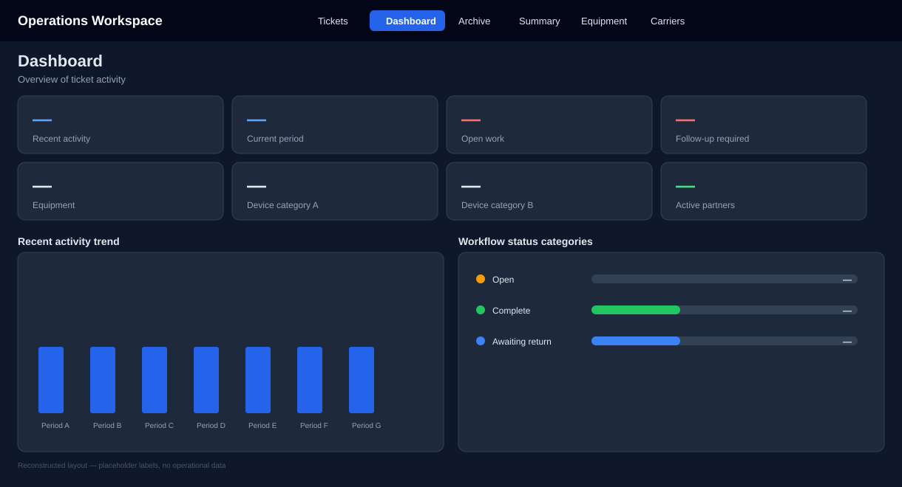
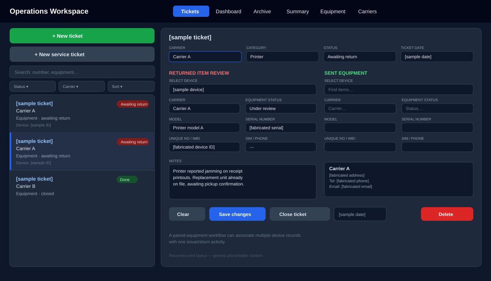
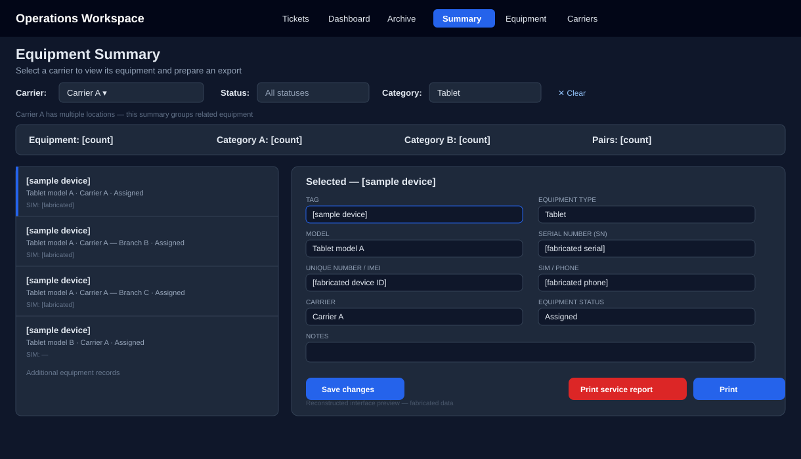
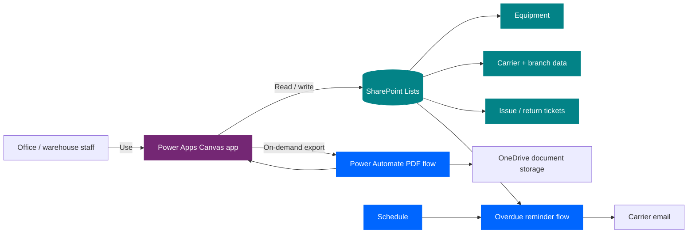

# Equipment Inventory | Power Platform Case Study

[](https://www.microsoft.com/power-platform/products/power-apps)
[](https://powerautomate.microsoft.com/)
[](https://www.microsoft.com/microsoft-365/sharepoint/collaboration)
[](docs/ARCHITECTURE.md)

> **A documentation-first Power Platform case study** exploring inventory, partner relationships, issue/return workflows, reporting, and follow-up patterns.

## What this project demonstrates

**Problem → documented approach → portfolio value**

| Problem | Solution | What it shows |
|---|---|---|
| Equipment assignment across partner organizations can become difficult to track consistently. | The case study describes a Canvas app approach connecting equipment records, partner branches, issue/return workflows, and summaries. | Translating an operational need into a structured application concept. |
| Staff need useful status and follow-up context, not only a device list. | The documented interface includes inventory, workflow, archive, and reporting views. | UX thinking and low-code workflow design. |
| Reporting and reminders can require repetitive manual steps. | The case study outlines document-generation and scheduled-notification patterns using Power Automate. | Integration awareness across Power Apps, Microsoft 365, and cloud automation. |

## Project at a glance

| | |
|---|---|
| **Platform** | Power Apps Canvas, Power Automate, SharePoint |
| **Intended users** | Operations and inventory staff |
| **Domain** | Equipment inventory and partner operations |
| **Concepts** | Equipment, partners, locations, issue/return workflows |
| **Documented patterns** | Reporting and scheduled notifications |
| **Repository scope** | Sanitized portfolio documentation and reconstructed previews |

> **Sanitized by design:** the source implementation and private environment are not included. This repository contains no app package, credentials, tenant identifiers, production schemas, or personal data.

## Review it in 60 seconds

1. **Review the interface concepts:** [dashboard](screenshots/dashboard-mockup.svg), [issue/return workflow](screenshots/tickets-mockup.svg), and [partner summary](screenshots/carrier-summary-mockup.svg).
2. **Follow the proposed system structure:** [Architecture](docs/ARCHITECTURE.md) summarizes the platform components and workflow patterns.
3. **Check the evidence boundaries:** [Visual evidence methodology](docs/VISUAL_EVIDENCE.md) explains what is reconstructed and what is not included.

## What the case study covers

- Issue/return workflow concepts for individual or paired equipment.
- Equipment and partner record views, with support for regional locations.
- Operational status, history, and summary views.
- Reporting and scheduled-notification patterns using Power Automate.

## Interface evidence

These are **reconstructed interface previews**, not screenshots from a live application. The repository does not contain a Canvas App package or production captures. All names, contacts, identifiers, quantities, dates, locations, and statuses are generic placeholders; layout and colors are illustrative.

See [Visual evidence methodology](docs/VISUAL_EVIDENCE.md) for the source basis and limitations.

<p align="center">
  
</p>

<p align="center">
  
  
</p>

| Area | Evidence |
|---|---|
| Issue / return workflow | [tickets-mockup.svg](screenshots/tickets-mockup.svg) |
| Operational dashboard | [dashboard-mockup.svg](screenshots/dashboard-mockup.svg) |
| Branch-aware carrier summary | [carrier-summary-mockup.svg](screenshots/carrier-summary-mockup.svg) |
| Equipment master data | [equipment-management-mockup.svg](screenshots/equipment-management-mockup.svg) |
| Carrier master data | [carrier-management-mockup.svg](screenshots/carrier-management-mockup.svg) |
| Historical archive | [archive-mockup.svg](screenshots/archive-mockup.svg) |

## Architecture in one view



Illustrative architecture concept; not a verified deployment topology. For design rationale, see [Architecture](docs/ARCHITECTURE.md).

## Engineering highlights

- **Domain modeling:** separating partner organizations from their locations.
- **Power Apps integration:** documenting considerations around list-backed data and formula field names.
- **Low-code operations:** describing how app data and cloud automation can share a Microsoft 365 data layer.
- **Reporting and follow-up:** outlining document generation and scheduled-notification patterns.
- **Maintenance awareness:** noting platform constraints, delegation, and validation boundaries.

## What it demonstrates to an employer

- Translating an operational problem into a structured low-code solution concept.
- Designing user-facing status, master-data, archive, and reporting views.
- Understanding integration patterns across Power Apps, Power Automate, SharePoint, and Microsoft 365.
- Considering maintainability, integration boundaries, privacy, and deployment constraints.
- Presenting a case study with clear scope and evidence limits.

## Repository contents

```text
README.md                         Project overview and navigation
docs/
  ARCHITECTURE.md                 System boundaries, data flow, workflows, and tradeoffs
  VISUAL_EVIDENCE.md              Reconstruction basis and fidelity limitations
CONTRIBUTING.md                   Portfolio accuracy and privacy guidance
.gitignore                        Common OS and editor artifact exclusions
screenshots/                      Original illustrative SVG interface mockups
```

## Scope and privacy

- This repository is documentation-only; there is no local build or deployment command.
- Exact SharePoint schemas, tenant configuration, automation definitions, and production data are not included.
- Mockups illustrate interface concepts only and must not be interpreted as live application screenshots.
- See [CONTRIBUTING.md](CONTRIBUTING.md) for privacy and showcase accuracy rules.

## Author

**IT Automation & Power Platform Developer**
