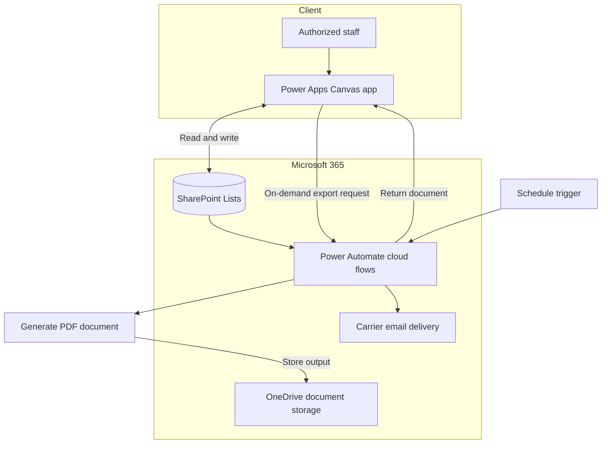

# Architecture and Engineering Rationale

This document presents a sanitized, high-level architecture concept for the portfolio case study. It does not expose a production system design or tenant-specific configuration.

**Recommended reading order:** system context → core workflows → engineering decisions → scope and privacy.

## Executive summary

The case study illustrates a three-part operational system:

1. **Power Apps Canvas app** — task-focused interface for staff.
2. **SharePoint Lists** — shared business data and system of record.
3. **Power Automate patterns** — document generation and scheduled notifications.

## System context

The case study concerns operations staff responsible for equipment assignment across partner organizations. It groups the problem into three areas:

1. **Equipment inventory** — device category, status, assignment, and notes.
2. **Partner relationships** — organization and location context.
3. **Operational workflow** — issue/return activity, status, history, reporting, and follow-up.

## Illustrative logical components

This diagram is conceptual and does not represent a verified production deployment topology.

## System boundaries

| Boundary | Responsibility |
|---|---|
| Canvas app | User interaction, navigation, filtering, workflow actions, status views, and report requests. |
| SharePoint Lists | Shared list-based records and relationships. |
| Power Automate | Document-generation and scheduled-notification patterns. |
| Microsoft 365 services | Example storage and message-delivery components. |

This separation illustrates how user interaction, shared records, and automation can be organized across Microsoft 365 services.

## Data model

The data model is presented at a logical level rather than with tenant-specific schemas.

| Entity | Purpose |
|---|---|
| Equipment | Represent tablets and mobile printers, identifiers, model information, status, carrier assignment, and operational notes. |
| Carrier | Represent an external contracted carrier organization. |
| Branch | Represent regional carrier branches when a carrier operates across multiple locations. |
| Ticket | Record equipment issue and return activity, selected device data, status, and lifecycle timestamps. |

Separating partner organizations from locations allows summaries to group relevant inventory across locations. Workflow and inventory views should use consistent status terminology.

## Core workflows

### Issue and return ticket

1. A user selects equipment and partner context.
2. The workflow can represent individual or paired equipment.
3. A record captures the handoff and current status.
4. Return actions update workflow and inventory state.
5. Historical activity remains reviewable.

### Carrier summary and export

1. A user filters a partner equipment view by available dimensions.
2. The system prepares a summary.
3. An export request can invoke a document-generation flow.
4. A cloud flow can generate and store a document.

### Overdue reminder

1. A scheduled process checks workflow state.
2. It identifies records that meet the configured follow-up criteria.
3. A notification is prepared for the relevant contact.

## Engineering decisions

### SharePoint lists as the system of record

SharePoint lists are one possible shared data layer for a Canvas app and cloud flows. Integration work needs to account for display names, internal names, data types, relationships, and delegation behavior.

### Server-side PDF generation

The case study outlines Power Automate as a document-generation option rather than depending solely on in-app printing.

### Scheduled reminders

Scheduled automation is a pattern for making follow-up repeatable and independent of an active app session.

## Implementation lessons

- **Model workflow state explicitly.** Inventory, ticket, carrier, and branch concepts serve different operational purposes and should not be flattened into one free-form record.
- **Keep naming consistent.** SharePoint display names and Power Fx field names need explicit handling; that matters both for formulas and for maintainable integration.
- **Separate interaction from document generation.** The Canvas app should request an export while the flow owns report assembly and output.
- **Design for platform behavior.** Delegation, data types, legacy controls, and validation coverage should influence implementation and support decisions.
- **Preserve privacy in the public story.** Repository polish must communicate the solution without exposing a private tenant, customer records, or production identifiers.

## Evidence and limitations

The repository demonstrates architecture and interface concepts through written documentation and generic SVG mockups. It does not include source artifacts that substantiate production deployment, measured adoption, performance benchmarks, or a runnable public demo.

The documentation describes high-level concepts and labels reconstructed visuals as illustrative.

### Platform considerations

The conceptual approach should account for platform behavior such as:

- Canvas app delegation and control behavior.
- SharePoint and Power Fx data typing differences.
- PAC CLI validation coverage being narrower than a full tenant and app test.
- Legacy controls or formulas needing extra care during maintenance.

## Privacy and reproducibility

Private implementation details are intentionally omitted. A reproducible public package would require a sanitized schema, sample data, a tenant-independent setup process, and environment-specific connection documentation. Without those assets, this repository is a case study rather than an installable implementation.
